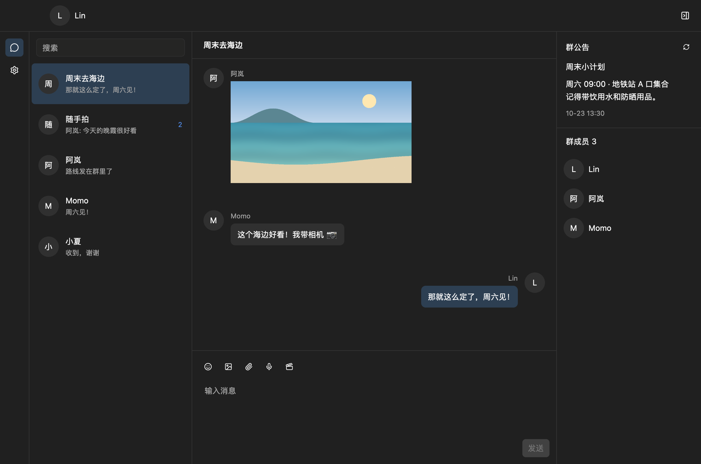

  

<h1 align="center">Ferrsphen</h1>

Ferrsphen 是一个使用 Rust 与 GPUI 编写的跨平台 [IM](https://en.wikipedia.org/wiki/Instant_messaging) 客户端，支持 **macOS、Windows 和 Linux**。

Fersphen 是 ferris 和 spheniscidae (拉丁语 / 企鹅科) 的结合。

项目目前处于**早期迭代**阶段，仍有很多功能尚未实现，现有功能和界面还在持续完善。

## 感谢

- atri_qq: https://github.com/LaoLittle/atri_qq
- ricq: https://github.com/lz1998/ricq
- GPUI/Zed: https://github.com/zed-industries/zed
- gpui-kit: https://github.com/longbridge/gpui-kit
